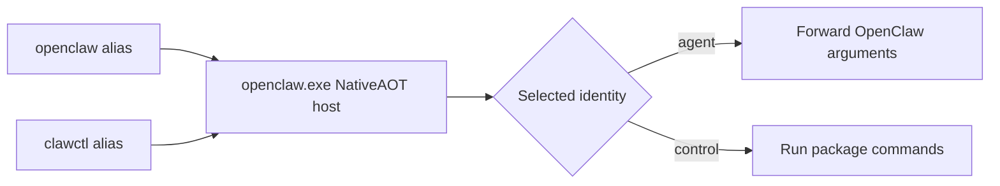
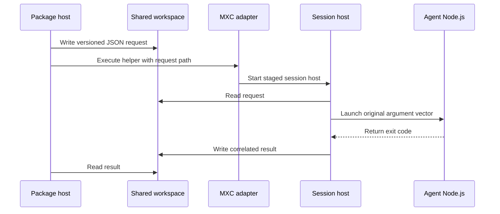
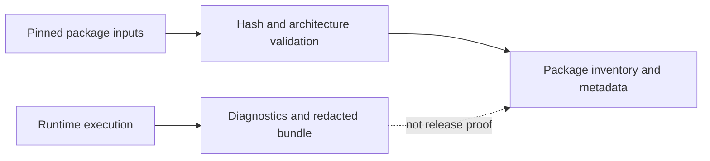

# Architecture

This is an explanation of how the Windows MSIX host is put together for
contributors. It describes the boundaries that preserve a packaged,
NativeAOT-hosted OpenClaw while running the application in an isolated agent
session. It does not own the command catalog or the installed-data inventory:
those remain in the [README command model](../README.md#command-model) and
[installed-data](../README.md#installed-data).

## The host is one binary with two entry points

The package contains one NativeAOT executable, `openclaw.exe`, but exposes it
through two package application identities and aliases: `openclaw` for the
OpenClaw CLI and `clawctl` for package lifecycle and diagnostics. The two
identities are intentional, rather than two copies of a host:

- [`Package.appxmanifest`](../src/OpenClaw.Launcher/Package.appxmanifest)
  binds both application entries and aliases to the same executable.
- [`HostEntrypoint.cs`](../src/OpenClaw.Launcher/HostEntrypoint.cs) selects the
  control identity from the package-qualified application ID when available,
  or from the invoked alias otherwise.
- [`HostStartup.cs`](../src/OpenClaw.Launcher/HostStartup.cs) supplies the
  production collaborators: selected entry point, diagnostic log, package
  base directory, process streams, and installation lifecycle.
- [`Program.cs`](../src/OpenClaw.Launcher/Program.cs) keeps the two surfaces
  separate after startup. The agent surface forwards OpenClaw arguments; the
  control surface owns the package commands.

A third package application, `GatewayRecovery`, is not a host entry point. It is
the separate windowless sign-in helper that logon recovery starts, and it only
runs the control surface's `gateway-service start --recovery`; see
[Gateway lifecycle](#gateway-lifecycle-is-recorded-observed-and-restarted-at-logon).

This arrangement makes the user-facing distinction enforceable by package
activation, while avoiding two launchers that could drift in AOT settings,
diagnostics, or runtime composition. It also protects transparent forwarding:
`openclaw` arguments are OpenClaw-owned and never become `clawctl` options.

## Completion stays owned by the installed runtime

`clawctl completion` writes completion for both aliases to standard output.
`clawctl completion --install` adds a marked loader to the invoking user's
PowerShell profile. Each new shell resolves the installed `clawctl` application
and sources its current completion output, so package updates do not require a
profile rewrite. The profile update changes only the marked byte range and
replaces the file atomically, so an existing profile's encoding, line endings,
and unrelated content survive.

The payload build asks the pinned OpenClaw application to generate its
PowerShell completion script, validates the result, and includes those
immutable bytes in the application inventory and signed package. Installation
copies that trusted package asset into host LocalState. Before `clawctl pwsh`
opens an interactive shell, the launcher refreshes an installed cache from the
current package, then projects it through a generation-checked
`SessionWorkspaceOperation`, which rejects guest-controlled path redirection.
The workspace copy is disposable and is removed rather than loaded when the
authoritative host cache is absent. One-shot `--command` and `--file` execution
does not project or load completion.

All three `pwsh` modes use the attached session-command path. The request keeps
PowerShell's executable, argument vector, shared-workspace working directory,
environment, and PATH prefix as data through the guest helper. Interactive
mode supplies `-NoExit` plus prompt and completion preparation. Command mode
supplies one explicit `-Command` string; it does not reconstruct that string
from multiple caller arguments. File mode supplies `-File`, the agent-visible
path, and each script argument separately. Relative paths therefore start in
the shared workspace, while `~` and absolute paths belong to the agent
identity. The host does not stage arbitrary script content.

## Setup creates an explicit, isolated execution boundary

`clawctl setup` creates and records the isolated session. An `openclaw`
invocation whose setup marker is absent provisions that same boundary before
forwarding its arguments, including for `--help` and `--version`. It never runs
OpenClaw on the host.

Automatic setup is deliberately narrow. An unreadable, incomplete, foreign,
newer-schema, preparing, or tearing-down marker, a session mismatch, and a
stale agent Node.js runtime remain explicit recovery states with their existing
`clawctl setup` or `clawctl teardown` guidance. Automatic setup does not repair
degraded state. The lifecycle lock double-checks an absent marker so concurrent
first launches provision once.

[`SetupStateStore`](../src/OpenClaw.Launcher/Session/SetupStateStore.cs)
persists the setup phase and its durable outcome. [`SessionRuntime`](../src/OpenClaw.Launcher/Session/SessionRuntime.cs)
composes the shared backend, state stores, helper, and lifecycle lock for both
entry points. [`SessionCoordinator`](../src/OpenClaw.Launcher/Session/SessionCoordinator.cs)
owns the recorded session lifecycle and protects it from concurrent lifecycle
operations. [`SessionExecutor`](../src/OpenClaw.Launcher/Session/SessionExecutor.cs)
turns a validated request into work inside that owned session; setup calls its
runtime installation path explicitly rather than leaving the first gateway or
OpenClaw invocation to do it.

The separation is consequential: state says what this installation recorded,
whereas inspection asks the isolated session what is actually running. A stale
record is therefore not treated as proof that the session is healthy.

## The guest helper carries data, not a user command line

MXC's current execution route accepts a command-line string and flattens it
through `cmd.exe`. Passing the OpenClaw argument vector through that boundary
would allow shell expansion and quoting changes. The
[`OpenClaw.SessionHost`](../src/OpenClaw.SessionHost/Program.cs) helper is the
guest-side adapter: it receives a request-file path, reads the actual request
as JSON, and launches the requested process with the original argument vector.

[`OpenClaw.SessionProtocol`](../src/OpenClaw.SessionProtocol/SessionLaunchProtocol.cs)
defines the AOT-safe JSON contracts shared by host and helper. Each contract
has a schema version and explicit JSON property names; the protocol validates
the expected version and writes a correlated result file. When publication
succeeds, helper failures are reported in that result so the host can
distinguish an operation failure from a transport failure. A malformed helper
invocation without a request path can only report usage on stderr and exit
with the helper failure code.

The helper must be copied before it can run. [`SessionHelperStager`](../src/OpenClaw.Launcher/Session/SessionHelperStager.cs)
stages the immutable packaged helper in the session's shared workspace because
the isolated agent identity cannot execute a binary directly from another
package identity's WindowsApps directory. The shared workspace is visible to
both identities. This is a required execution bridge, not a caching or startup
optimization; staging verifies the packaged source and reports a staging
failure rather than silently substituting another executable. Gateway start
(including logon recovery) refreshes this versioned helper under the installation
lifecycle lock before inspecting a retained Gateway process. It reuses the
configured session without rewriting setup, identity, or profile data. Status
only requires an already staged helper and never stages one.

Runtime installation and log collection report a correlated failure result
when the operation fails. If that failure result cannot be published, the
helper reports the primary and publication errors together on stderr and
retains failure exit code `64`. Those messages keep file paths, are bounded in
length, and have credential-shaped values redacted on a best-effort basis.
This fallback requires helper entry; a successful MXC spawn alone does not
prove that the staged helper loaded or ran.

When a plain helper exchange such as runtime installation, tool installation,
config readiness, or collection leaves no result file, the host reports how the
helper ended, followed by the guest's output. Exit code `64` means the helper
failed and could not write its result, and `0` means it exited without one.
Any other code means `cmd.exe` could not start the staged helper or the helper
stopped before reporting, for example when `cmd.exe` prints `Access is denied`
and exits `1`.

Before starting an attached child, the helper initializes its own console's
input and output to UTF-8. Host-side encoding does not set the isolated
console's code page; without guest initialization, PowerShell can corrupt
Unicode terminal and redirected text.

## Packaging consumes the SDK API; MXC provides isolation

The boundary with MXC has two responsibilities that should not be conflated:

- [`Directory.Packages.props`](../Directory.Packages.props) selects the
  official `Microsoft.Mxc.Sdk` NuGet version.
  NuGet and the .NET build/publish pipeline acquire and copy its runtime assets;
  the SDK owns native library resolution. Packaging does not register a custom
  resolver, inspect a native file set, or maintain per-binary pins.
  [`Get-MxcSdkMetadata.ps1`](../scripts/Get-MxcSdkMetadata.ps1) copies the
  mandatory MIT copyright/permission notice and records descriptive package
  version and build architecture, not a native-binary inventory.
  [`MxcRuntimeLocator`](../src/OpenClaw.Launcher/Mxc/MxcRuntimeLocator.cs)
  reads that optional metadata for diagnostics only. Availability is observed
  through SDK calls and their errors, never inferred from file presence.
- MXC owns containment and its wire contract.
  [`MxcSdkSessionClient`](../src/OpenClaw.Launcher/Mxc/MxcSdkSessionClient.cs)
  calls `Microsoft.Mxc.Sdk.V1.MxcLifecycle` in process and translates typed
  results/errors into the package-owned lifecycle boundary. There is no
  executor process or package-authored MXC JSON envelope.

Interactive foreground commands use the SDK's public PTY API, with the host
bridging input/output, terminal size, and console restoration. Redirected or
mixed streams use separate pipes; helper capture closes unused stdin and
drains both output streams concurrently. The tagged IsolationSession SDK kill
reaches only its foreground command processor, not the guest helper's tree.

This branch prototypes per-invocation cleanup with
[`WindowsInvocationJob`](../src/OpenClaw.Launcher/WindowsInvocationJob.cs).
The host creates a job and per-invocation lifecycle events. The helper's internal
`--request-in-job=<id>` mode joins the job before starting any workload, then
checks the event so a delayed, already-cancelled spawn cannot start late work.
An outside-job helper coordinator uses query-only job access and its agent
identity to pin member process handles.
Console Ctrl+C and Ctrl+Break leave that coordinator alive to finish pinning
and drain acknowledgement; its process-local handler is not inherited by the
worker, which retains normal console interruption behavior.
Cancellation and normal completion
close process admission before that snapshot by lowering the active-process
limit to one; existing members remain available to pin, but new child creation
is refused. The host explicitly terminates only after pinning is acknowledged.
The coordinator waits the pinned handles, including its worker helper, before
acknowledging drain and exiting. Only then does the SDK adapter join output
EOF and release invocation files. Detached gateway supervision is unchanged.

The earlier zero-member/completion-packet candidate failed strict process-handle
exit proof. The coordinator replaces that discovery path rather than treating
job accounting as completed process exit. A positive member PID from that
post-admission snapshot is opened with the fixed query-limited/synchronization
mask. Only `ERROR_INVALID_PARAMETER` (87) identifies an already-expired PID in
this context, following the same .NET process-lifetime handling. Access denial,
other native errors, invalid snapshot IDs, and valid handles that no longer
belong to the exact job remain explicit failures. Every retained handle still
requires a signaled wait; no exit-code or job-count shortcut replaces it.
Failed drain closes supported SDK output readers before joining them; closing
readers does not count as process exit. The agent receives no host-process
duplication or job-termination access.

This is ordinary process-leak control, not an authorization boundary against
hostile same-identity code. Explicit termination does not depend on the last
job handle closing; kill-on-close remains only a host-death fallback and is not
guaranteed against retained handles. Older helpers reject the new
`--coordinate-invocation=<id>` mode without starting a workload. State-transfer
workers (backup, restore, recovery) use the same lifetime through the paired
`--coordinate-state-transfer=<id>` and `--state-transfer-in-job=<id>` modes, so
Ctrl+C stops the exact worker tree before the exchange files are released; a
cancelled restore whose prepare step already recorded its activation is rolled
back automatically. The other helper modes (runtime/tool installation,
inspection, collection, configuration checks) still run as plain executions. The JSON
protocol version is unchanged; the branch-local modes and events require a
matching host/helper. Local regressions, managed quality, the full Release
suite, and the observed cross-identity NativeAOT scenarios pass; the remaining
limits and unrun lanes are recorded in the
[operational evidence](mxc-compatibility-evidence.md#branch-local-descendant-cancellation-prototype).
Dispatched lifecycle calls are not abandoned, so a provision's identity can
always be recorded.

The result is a narrow trust boundary: this repository decides exactly which
runtime is packaged and verifies it, but does not reimplement MXC's process
and session isolation semantics.

## Node belongs to the agent account

The Node archive is package content, but [`SessionRuntimeInstaller`](../src/OpenClaw.SessionHost/SessionRuntimeInstaller.cs)
runs inside the isolated agent and extracts Node into that account's profile,
not the package host's LocalState. The two identities do not share readable
per-account package state. Extraction by the account that will execute Node
also gives that account ownership of the extracted files.

Runtime reuse checks executable PE headers before entering the Windows loader.
A corrupt non-executable runtime is repaired from the selected package archive
instead of reaching `Process.Start`, whose creation wait precedes the process
exit timeout. This does not add a packaging-owned Node.js version policy.

The installer version-checks the extracted runtime and can prepend its runtime
directory to the agent user's `PATH`. Launch requests also carry a
process-specific path prefix, so Node is discoverable by the intended guest
process without changing the host process's `PATH` or depending on an
arbitrary machine-wide Node installation.

## Gateway lifecycle is recorded, observed, and restarted at logon

The gateway is an optional background process inside the same recorded agent
session. [`GatewayController`](../src/OpenClaw.Launcher/Gateway/GatewayController.cs)
coordinates its start, stop, and health inspection; it does not infer liveness
from a persisted record. [`GatewayConfigurationStore`](../src/OpenClaw.Launcher/Gateway/GatewayConfigurationStore.cs)
persists launch choices because the later logon task has no interactive caller
from which to recover them. [`SchTasksGatewayScheduler`](../src/OpenClaw.Launcher/Gateway/SchTasksGatewayScheduler.cs)
uses the inbox `schtasks.exe` and a task registered for the signed-in user's
logon. XML readback uses the Task Scheduler API through inbox Windows PowerShell
and explicit UTF-8 output, preserving Unicode profile paths that `schtasks`
would convert lossily to the system code page. This keeps COM outside the
NativeAOT launcher and avoids elevation that would make the task
user-unmanageable. After registration, the
persistence manager reads the task back before reporting recovery ready or
removing a Startup-folder shortcut. Trigger or principal drift reports the
expected and observed identities; an unreadable result remains unknown. The
owning token SID and the interactive logon SID remain separate for account
compatibility, rather than silently redirecting recovery to another user.

Both recovery lanes start the windowless sign-in helper,
[`openclaw-gateway-recovery.exe`](../src/OpenClaw.GatewayRecovery/Program.cs), a
Windows-subsystem NativeAOT executable that the package declares as its own
`GatewayRecovery` application. It has no console, so nothing at sign-in opens a
window, even when Windows Terminal is the default terminal. The logon task's
only action is the helper's quoted package-qualified execution alias,
`%LOCALAPPDATA%\Microsoft\WindowsApps\<package family>\openclaw-gateway-recovery.exe`,
with no arguments. Windows recreates that alias on every package update, unlike
the versioned install directory, so the registration survives updates. Setup
reads the alias name from the installed manifest through
[`PackageExecutionAlias`](../src/OpenClaw.Launcher/PackageExecutionAlias.cs), so a
side-by-side development identity registers its own renamed alias. When Task
Scheduler refuses the registration, setup instead writes a Startup-folder
shortcut, `OpenClaw Gateway <package family>.lnk`, to the same alias through the
shell's ShellLink object. Its description marks it as OpenClaw's; a same-named
shortcut without that marker is reported, never replaced or removed. Setup writes
only into an existing Startup folder: a folder created from inside the package
would be redirected into the package's private AppData, which Explorer does not
read at sign-in. Status and install report recovery as needing action when the
helper alias is missing, rather than registering a lane that would fail silently.

The helper resolves this package's `Control` alias from the same manifest,
starts `clawctl gateway-service start --recovery` with `CreateNoWindow` and the
user profile as its working directory, waits, and returns that command's exit
code, so the task's last-run result is the recovery result. It appends what
happens before that command starts, including a missing alias, to the host
diagnostic log, and it never shows UI. Interactive CLI commands keep their
normal terminal output.

Earlier generations ran a generated launcher instead: a CMD file, then
`gateway-launcher.js` through Windows Script Host, each calling a PowerShell
activation script, with a Startup-folder `.cmd` or `.wsf` fallback. Those files
carry a generator marker. Status reports a task that still runs them as not
matching this installation, and reports a marked file that remains as needing
action. An explicit `clawctl setup` without `--fresh` reuses the recorded session,
keeps its data and gateway settings, replaces the logon action, and then removes
only marked legacy files; teardown removes them too. If an existing task cannot
be replaced, the new shortcut is written but the files that task still runs are
retained, and setup reports that migration still requires action. Recovery no
longer depends on Windows Script Host, so a host disabled by policy cannot block
sign-in once the task has been migrated.

The real control command is `gateway-service`, not `gateway`. The configured
port is distinct from the upstream default. The launcher does not force the
default into the child command line, and status never uses it as a fallback
address: only a configured or observed listener can be reported. This lets
OpenClaw resolve its own configuration and prevents a packaging-side default
from overriding upstream behavior or sending a user to a port that was never
observed.

`gateway-service restart` performs the existing stop and start operations
under one lifecycle lock. A missing or already-exited gateway makes the stop a
no-op and the start continues. If the gateway cannot be confirmed stopped, the
operation retains its ownership record and does not launch a replacement.

Start and restart wait up to 90 seconds for an owned listener. A verified live
supervisor with no listener can then return successful acceptance with
`gateway.state: "starting"`; this is not a running or credential-handoff claim.
The record remains available for inspection and stop, and clients keep their
own bounded readiness wait. Inspection failures, terminal supervisor failures,
and listener conflicts remain unsuccessful starts.

Process access denial is not evidence that a recorded PID belongs to another
process. Inspection uses query rights instead of requesting a full-access
handle. If Windows denies inspection or termination, the session helper reads
the OS process creation-time snapshot without opening the target. Only an
observed missing PID or creation-time mismatch permits stale-record recovery.
A matching identity or unavailable snapshot remains unknown: its record stays
intact and no replacement is launched. Stop still pins and verifies its handle
before termination, and never kills a PID selected only by a snapshot.

## Companion uses the package's isolated session

The Windows Companion app selects the current-user Gateway MSIX by its exact
package registration and qualified `clawctl.exe` alias. It probes
`clawctl status --json` for the versioned `isolated-session` integration
contract. Operational exception responses retain this capability metadata with
`ok: false`, the selected command, and the original error. Capability does not
assert session readiness or authorize credential handoff: Companion can reach
its existing explicit package setup step, whose successful ready-session
response is still required. Status itself never provisions or repairs a session.
After setup, `clawctl companion prepare --port <port> --json`
instructs [`SessionCompanionConfig`](../src/OpenClaw.SessionHost/SessionCompanionConfig.cs)
to read the agent's effective Gateway configuration through upstream-owned
runtime code. The packaged `plugin-sdk/health` snapshot reader runs with
observation and suspicious-config recovery disabled, using core-only validation
to avoid plugin-state and migration reads. The public
`openclaw config get` display command is redacted and
is not a credential-delivery path. A successful existing configuration must
have `gateway.mode: "local"` and a loopback bind when specified; otherwise
Companion requires explicit recovery rather than starting a Gateway with an
incompatible mode. A wholly absent or empty Gateway can be initialized; a
partially configured Gateway without local mode requires explicit recovery.
Implicit password authentication is incompatible even when a token is also
present. When an effective local loopback token configuration already exists,
prepare returns it without rewriting the configuration file. Otherwise the
agent uses packaged upstream `plugin-sdk/config-mutation` to create missing
values under the upstream mutation lock. The original config path, root hash,
and effective Gateway must still match, including values read from `$include`
files; a concurrent edit fails rather than being overwritten.
Before pairing and publishing Companion's record, the package-qualified
`clawctl companion prepare --check --json` returns the agent's effective port
and token so Companion can compare them with its setup record. This check
neither patches configuration, restores backups, nor records config-health
observations. The response contains a credential and must be kept private.
The host does not write a second profile, inherit the invoking user's profile
overrides, or select device-installed Node.js. The agent rejects profile and
Gateway overrides both before and after upstream environment loading, and
requires the upstream-selected config path to match the agent's default
profile. Incompatible configuration
requires explicit recovery rather than overwriting credentials.

[`GatewayController`](../src/OpenClaw.Launcher/Gateway/GatewayController.cs)
starts, stops, and inspects the Gateway on Companion's behalf.
When listener attribution is available, `clawctl gateway-service status --json`
reports the recorded sandbox and agent SID alongside guest-observed listener
process IDs, creation times, sequence numbers, and ports.
Guest process-sequence snapshots bracket the listener and ancestry
observations. Each listener and every ancestor used in attribution must have
the same nonzero sequence in both snapshots; creation times come from that
same tree observation.
Those fields are evidence from the trusted package-qualified invocation, not
a bearer credential or sufficient proof when copied out of context. Companion
compares them with two fresh host-side listener and OS process-sequence
snapshots before any credential handoff. The agent's process DACL denies
cross-account process handles to Companion, so a host process-start-time or
token-SID query cannot be the ownership check. Windows 11 builds with
`SystemBasicProcessInformation` expose an OS-owned per-process sequence
without opening that handle. Gateway health and lifecycle still use the
isolated process-tree and observed listener checks when process sequences are
unavailable; in that case the package omits `gateway.ownership` and Companion
fails closed before sending credentials. Unknown, incomplete, or replaced
listeners fail closed instead of accepting a reused PID.

Pairing uses package-qualified `openclaw devices list --json` and
`openclaw devices approve <request-id> --json` in the isolated session.
`openclaw` runs transparently as the agent user and reads that account's
configuration; Companion does not write a host-profile config or pass a token
through command-line arguments or environment overrides. Before each command,
Companion verifies the live listener and checks that the agent's port and token
still match its setup record. It matches the pending request to its own device
ID and public key, then approves only that exact request.

## State transfer preserves the current session identity

[`StateTransferCoordinator`](../src/OpenClaw.Launcher/StateTransfer/StateTransferCoordinator.cs)
owns host-side backup, restore, and recovery orchestration. It requires ready
setup, starts only the recorded session, binds exchanges to its generation, and
uses its staged helper and agent-owned Node.js runtime. The archive store
publishes hash/length-checked files without overwriting an existing destination.
Listing that store does not contact MXC.
Archive files receive a protected DACL when their handle is created, before
credential bytes are written; inherited readers of the archive folder do not
gain access. The shared `TrustedPath` owner also creates the per-command
exchange for the invoking user and recorded agent, excluding broad parent
readers. Upstream scratch remains in that private exchange. Guest transaction
and normalization roots are private to the agent, SYSTEM, and administrators.
Existing folder, profile, and archive permissions are not rewritten.

[`SessionStateTransfer`](../src/OpenClaw.SessionHost/SessionStateTransfer.cs)
owns guest preparation, activation, and rollback.
[`StateArchiveApplication`](../src/OpenClaw.SessionHost/StateArchiveApplication.cs)
invokes immutable packaged OpenClaw for inventory, canonical SQLite snapshots,
verification, and fresh-target extraction. It inspects configuration through
the upstream SDK and relocates only declared filesystem fields and `$include`
documents in staging, never arbitrary credential/history strings. Missing,
external, relative, or environment-dependent required paths remain explicit
automatic-recovery refusals. Windows/profile portability is not account or
package migration.

Restore verifies and prepares before asking the existing gateway owner to stop
the managed gateway. It acquires exclusive state access, captures and retains
verified current-state protection, and only then requests activation. Asset
roots are collapsed to non-overlapping profile-relative mappings. A durable,
source-generated journal outside `.openclaw` records the current profile
identity, transaction, prepared-tree digest, asset identities, protection, and
progress before same-volume moves. Activation rechecks the prepared contents
before moving any original data. Rollback reconciles recorded identities with the moved
objects, including interruption between a move and its next host response.
It does not terminate an unrelated process or treat journal paths as
unrestricted authority. Backend/setup identity is never replaced.

[`SessionStateAccess`](../src/OpenClaw.SessionHost/SessionStateAccess.cs)
owns one required cross-process access gate. Intent blocks new attached
launches, detached supervision, PowerShell, and configuration writers;
existing readers must finish before maintenance can obtain exclusive access.
A separate worker lease prevents rollback while an activation worker remains
alive. Kernel-released leases provide liveness without trusting a reusable PID.
The helpers own child process trees in kill-on-close jobs so a lease cannot end
while their descendants keep writing; disposing such a job closes admission, pins
every member by handle, terminates it, and waits on each pinned handle (not job
accounting) before the lease is released. A member that outlives termination
fails the operation; the state leases still unwind with that error, which is
deliberate fail-closed behavior rather than an unkillable process blocking every
later maintenance operation. The supervised gateway's job is published under a
name bound to its supervisor, so a stop that kills the supervisor still waits out
the whole gateway tree before it reports success. Inspection and diagnostics remain
available when activation is pending. Successful activation or explicit
rollback clears intent; an unreadable journal fails closed. Finalized state
remains finalized if deleting disposable transaction data or a private recovery
snapshot fails: the result names the retained directory in a cleanup warning
instead of falsely reporting interrupted activation. Retained archives are
not part of that cleanup.

Recovery's host-side
[`RecoverySource`](../src/OpenClaw.Launcher/StateTransfer/RecoverySource.cs)
reads only an explicitly selected old profile. It pins source identities,
refuses writable/locked files and reparse points, checks inventory stability,
and carries required profile-contained dependencies into a shadow profile.
The guest preserves WAL bytes in that shadow copy before invoking the upstream
canonical producer. The verified recovery archive is retained first, then fed
through ordinary restore. Neither recovery nor rollback recreates an old
Windows account, changes ACLs, provisions a new session, or restarts the gateway.

## Diagnostics and build inputs have different trust roles

[`HostDiagnosticLog`](../src/OpenClaw.Launcher/HostDiagnosticLog.cs) writes
host diagnostics beneath packaged LocalState when packaged, or the documented
per-user fallback otherwise. A named mutex keyed by the log path keeps
concurrent writers from interleaving records.

[`GatewayController`](../src/OpenClaw.Launcher/Gateway/GatewayController.cs)
records how long each gateway status inspection took and the state it
observed. [`SessionExecutor`](../src/OpenClaw.Launcher/Session/SessionExecutor.cs)
records how long each non-attached session exchange, such as the Control UI
handoff, took and its executor exit code. An inspection or exchange that
throws instead, including on cancellation, is recorded with its duration,
exception type, and any MXC error classification. Together they show where a
slow command spent its time without a debugger. They never include captured
output, exception messages, arguments, environment, URLs, or tokens.

Each host start records an `Environment:` entry from
[`HostEnvironment`](../src/OpenClaw.Launcher/HostEnvironment.cs): the Windows
build and update revision, OS and process architecture, the package full name
with the origin Windows recorded for the install (Developer Mode loose-layout
registration, Store-signed, or developer-signed MSIX) and its install path, the
compiled package and payload versions, the MXC SDK provenance and owned contract,
the packaged Node.js version, and the .NET runtime. Reading these facts starts
no process; the MXC backend probe is logged where support is checked instead.
The facts are descriptive only and never authorize an operation.

Failure records are separate from those timing records. Users see an
exception's message; the log records the whole failure through
[`DiagnosticFailure`](../src/OpenClaw.Launcher/DiagnosticFailure.cs): its type
and message, any MXC code, backend code, and failing operation, the Windows
error code behind I/O and native failures, and every inner cause. A message can
repeat guest-reported detail, such as an agent-profile path, which is why each
bundle warns to review it before sharing. The process's last-chance handler
also records the stack trace. The one deliberate omission is a browser launch
failure, whose message would repeat a Control UI URL that can carry the gateway
credential.

[`DiagnosticsBundle`](../src/OpenClaw.Launcher/Gateway/DiagnosticsBundle.cs)
collects troubleshooting material through the shared workspace while excluding
credential stores, and writes the collecting host's environment into its
manifest. It also reads every recent gateway launch's output log and supervisor
status from that workspace. It keeps a bounded tail of each and refuses reparse
points, because the guest can write there.
[`DiagnosticsRedactor`](../src/OpenClaw.Launcher/Gateway/DiagnosticsRedactor.cs)
redacts credential-shaped JSON members, URL parameters, environment-style
assignments, and authorization header credentials in the remaining text, the
manifest, and the notes the command returns. That redaction is deliberately
best-effort and does not make a bundle safe to share without review.

Diagnostics describe runtime evidence; they are not release verification.
The build path independently creates an inventory of package inputs and hashes
their content in [`Build-MSIX.ps1`](../scripts/Build-MSIX.ps1). That inventory,
the pinned MXC archive checks, and packaging metadata form the release trust
boundary: a successful process launch alone is not evidence that the intended
payload was packaged.

## End-to-end flow

1. Windows activates an alias; the one NativeAOT host identifies the agent or
   control application identity.
2. `clawctl setup` explicitly creates or repairs the isolated session, stages
   the helper, and installs the agent-owned Node runtime. When the setup marker
   is absent, `openclaw` performs that provisioning first.
3. For every other marker state, `openclaw` preserves the explicit recovery
   result rather than repairing it automatically.
4. `openclaw` loads the recorded session and sends a JSON launch request to
   the staged helper through the MXC adapter.
5. The helper replays the argument vector inside the agent session with the
   agent runtime first on that child process's path. If eligible, a successful
   interactive launch starts the managed gateway through this same boundary.

## Source map

| Concept | Authoritative tracked files |
| --- | --- |
| Package applications, aliases, and launcher dispatch | [`Package.appxmanifest`](../src/OpenClaw.Launcher/Package.appxmanifest), [`HostEntrypoint.cs`](../src/OpenClaw.Launcher/HostEntrypoint.cs), [`HostStartup.cs`](../src/OpenClaw.Launcher/HostStartup.cs), [`Program.cs`](../src/OpenClaw.Launcher/Program.cs) |
| Setup state and session lifecycle | [`SetupStateStore.cs`](../src/OpenClaw.Launcher/Session/SetupStateStore.cs), [`SessionRuntime.cs`](../src/OpenClaw.Launcher/Session/SessionRuntime.cs), [`SessionCoordinator.cs`](../src/OpenClaw.Launcher/Session/SessionCoordinator.cs), [`SessionExecutor.cs`](../src/OpenClaw.Launcher/Session/SessionExecutor.cs) |
| Guest protocol and helper staging | [`OpenClaw.SessionHost/Program.cs`](../src/OpenClaw.SessionHost/Program.cs), [`SessionLaunchProtocol.cs`](../src/OpenClaw.SessionProtocol/SessionLaunchProtocol.cs), [`SessionHelperStager.cs`](../src/OpenClaw.Launcher/Session/SessionHelperStager.cs) |
| MXC SDK API and redistribution notice | [`Directory.Packages.props`](../Directory.Packages.props), [`Get-MxcSdkMetadata.ps1`](../scripts/Get-MxcSdkMetadata.ps1), [`MxcRuntimeLocator.cs`](../src/OpenClaw.Launcher/Mxc/MxcRuntimeLocator.cs), [`MxcSdkSessionClient.cs`](../src/OpenClaw.Launcher/Mxc/MxcSdkSessionClient.cs) |
| State transfer and activation | [`SessionStateTransferProtocol.cs`](../src/OpenClaw.SessionProtocol/SessionStateTransferProtocol.cs), [`StateTransferCoordinator.cs`](../src/OpenClaw.Launcher/StateTransfer/StateTransferCoordinator.cs), [`SessionStateTransfer.cs`](../src/OpenClaw.SessionHost/SessionStateTransfer.cs), [`SessionStateAccess.cs`](../src/OpenClaw.SessionHost/SessionStateAccess.cs), [`StateActivationJournal.cs`](../src/OpenClaw.SessionHost/StateActivationJournal.cs) |
| Agent runtime installation | [`SessionRuntimeInstaller.cs`](../src/OpenClaw.SessionHost/SessionRuntimeInstaller.cs) |
| Gateway lifecycle | [`SchTasksGatewayScheduler.cs`](../src/OpenClaw.Launcher/Gateway/SchTasksGatewayScheduler.cs), [`GatewayController.cs`](../src/OpenClaw.Launcher/Gateway/GatewayController.cs), [`GatewayConfigurationStore.cs`](../src/OpenClaw.Launcher/Gateway/GatewayConfigurationStore.cs) |
| Logon recovery and the sign-in helper | [`GatewayPersistenceManager.cs`](../src/OpenClaw.Launcher/Gateway/GatewayPersistenceManager.cs), [`ShellStartupLinkStore.cs`](../src/OpenClaw.Launcher/Gateway/ShellStartupLinkStore.cs), [`PackageExecutionAlias.cs`](../src/OpenClaw.Launcher/PackageExecutionAlias.cs), [`GatewayRecoveryStart.cs`](../src/OpenClaw.GatewayRecovery/GatewayRecoveryStart.cs) |
| Diagnostics and payload integrity | [`HostDiagnosticLog.cs`](../src/OpenClaw.Launcher/HostDiagnosticLog.cs), [`HostEnvironment.cs`](../src/OpenClaw.Launcher/HostEnvironment.cs), [`DiagnosticFailure.cs`](../src/OpenClaw.Launcher/DiagnosticFailure.cs), [`DiagnosticsBundle.cs`](../src/OpenClaw.Launcher/Gateway/DiagnosticsBundle.cs), [`DiagnosticsRedactor.cs`](../src/OpenClaw.Launcher/Gateway/DiagnosticsRedactor.cs), [`Build-MSIX.ps1`](../scripts/Build-MSIX.ps1) |
